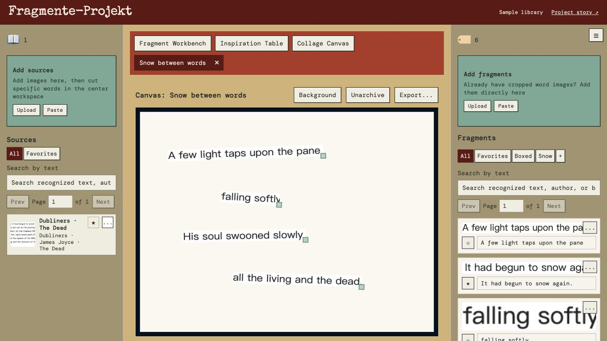

# Fragmente-Projekt

[English](README.md) | [简体中文](README.zh-CN.md)

## Try the Demo

**[Open the live demo](https://aliyehitomi359.github.io/Fragmente-Projekt/)** · **[中文展示](https://aliyehitomi359.github.io/Fragmente-Projekt/portfolio/zh.html)** · **[Try the app](https://aliyehitomi359.github.io/Fragmente-Projekt/?demo=1&lang=en)**

[](https://aliyehitomi359.github.io/Fragmente-Projekt/)

The bilingual project story includes actual desktop capture recordings and a full browser app with a separate sample library. No installation or login is required. Desktop screen capture itself requires the desktop build. This is an evolving MVP developed with AI coding assistance.

A local-first workspace for collecting text from images and composing collage poems. Built with React, TypeScript, Vite, IndexedDB and Electron. No account or backend is required. The application interface is currently English; Chinese localization is planned.

## Features

- Upload sources, select rectangular regions and save cropped fragments without altering the original image.
- Automatically recognize simplified/traditional Chinese, English and German with Tesseract.js; edit recognized fragment text directly.
- Organize fragments into boxes and favorites. Search text and source book/author notes with simplified/traditional Chinese matching.
- Scatter fragments on the Inspiration Table and collect a temporary session, optionally saved as a box.
- Create multiple collage canvases, move/resize/crop fragments, customize backgrounds and export PNG/JPG/WebP.
- Monitor desktop library folders. Classify root images in a dialog with hover previews; images in Sources/Fragments import automatically.
- Drag between the source and fragment panels to change classification and move the local image accordingly.
- Name local images after OCR or corrected text, followed by a three-character identifier. Copy uploads into the library while keeping originals.
- Back up/restore portable libraries and open the active library folder from the menu.

## Development

Use a current Node.js LTS version and npm.

```sh
npm ci
npm run dev
```

Open http://localhost:5175/. The port is strict: the server reports an error if occupied. Do not open index.html directly.

## Desktop preview
`npm run desktop:dev` opens the live development preview. React edits refresh automatically; Electron edits restart the app. It uses port 5175 and an independent `Fragmente-Projekt Preview Library` on your Desktop for image files; editing data uses the separate `Fragmente-Projekt-Development` application profile. It never uses your installed application's library. An existing Vite development server on 5175 is reused. Quit the preview with Cmd+Q or stop the terminal command.

`npm run desktop` builds the React app and opens Electron. First launch asks where to create the local library. Keep that directory intact. Import an exported web library to migrate existing browser work.

## Installers
`npm run package:mac` produces Mac DMG/ZIP in `release/` on macOS.
`npm run package:win` produces an NSIS installer on Windows.
Builds currently have no distribution signing identity. These are development previews, not signed public releases.

## Storage and limitations

Desktop Library settings includes **Open Library Folder**, the current path and **Move Library...**. Choose a parent folder (such as Desktop), then confirm. The installed app restarts; the development preview quits and completes the move on its next launch. After the old process exits, the complete library and Chromium editing database are copied and SHA-256 checked before the location is switched. The old folder is retained as a backup; new edits go only to the new folder. Existing destinations and nested locations are rejected. Do not manually move the active folder in Finder.

Installed apps create Sources, Fragments, Canvases and .app-data inside the chosen library; browser-data still contains the editing database. Keep the entire library intact. Development preview uses a separate Desktop library and application profile as described above.

Sources/Fragments hold image files; Canvases is currently reserved, not automatically populated with finished exports. Existing images are synchronized when the desktop interface starts. Inspiration sessions and table layouts are not yet restored after closing. OCR initially downloads language models and is not yet fully bundled for offline use.

The folder scanner checks about every three seconds. Root images stay in place until classified. Restore reads an exported manifest.json backup and updates matching records; it is not a full rollback of the current library.

## Verification

### Account-Free Local Network Transfer (Development)

Open the desktop app on both devices, connect them to the same private local network, then open **Library settings > Transfer over Wi-Fi**.

1. On the sending device, choose **Send > Create connection code** and confirm sharing.
2. Enter the six uppercase letters shown on the sender into **Receive** on the other device. Lowercase letters are automatically capitalized.
3. Click **Receive materials**. The app discovers the sender locally. Approve **Allow transfer** on the sending device, then review the received counts and click **Import materials**.
4. Close the dialog or choose **Stop sharing** when finished. Codes expire after ten minutes. To send changes back, reverse the roles.

No account, cloud service or Supabase configuration is needed. A temporary local IPv4 listener starts only after explicit confirmation. The six-letter code is a short identifier derived from a fresh local certificate, not an encryption password. The receiver pins the full certificate discovered on the LAN before sending application data, then transfers over TLS 1.3. The short identifier has only about 28 bits and does not provide strong standalone device identity; local discovery is not authenticated. For this reason each request also requires an explicit sender-side approval with the requesting IP address displayed. Approve only a transfer you just initiated on your other device, and use a trusted private network. No long-term account or device trust is stored. Local IP addresses, certificate fingerprints and transfer sizes are not hidden from the network. Discovery uses UDP multicast 239.255.83.71:48371; material data uses a temporary HTTPS port, not the discovery channel.

Transfers include source/fragment images, OCR text, favorites, source notes, boxes and source cut-region references. Canvases and Inspiration sessions are not transferred. This is a manual snapshot transfer, not continuous bidirectional synchronization. Local deletions are never propagated. Existing identical records are skipped; when same-ID records differ, confirmation imports the incoming snapshot as a separate copy with remapped references. This deliberately favors preserving both versions over overwriting edits. Retrying the same snapshot is idempotent; an interrupted write can be retried.

The first version supports desktop-to-desktop transfers only, with a 64 MB encoded transfer cap (45 MB of raw image bytes plus metadata). IPv6-only networks, browser/mobile receiving, incremental image transfer and resuming partial network downloads are not implemented. Discovery requires multicast access; if the network blocks it, use a different private network. The transport is platform-neutral, but a real Mac-to-Windows test is still required. Permit local-network access when the OS asks; do not disable the firewall. Guest Wi-Fi/client isolation or VPN routing can prevent a connection even on the same SSID. There is no need to expose Vite port 5175, forward router ports, or synchronize browser-data folders.

Tests: `node --test electron/lan-transfer.test.cjs` and `node scripts/test-material-transfer.mjs`. Network tests bind only to the loopback interface and use synthetic data.

```sh
npm run build
node --test electron/library.test.cjs
```

Mac/Windows installer workflows are available in GitHub Actions. Windows packaging and desktop interaction still need platform testing. Installers, personal images and library data are excluded from Git.

See [Desktop roadmap](DESKTOP-ROADMAP.md) / [桌面版路线图](DESKTOP-ROADMAP.zh-CN.md) for the planned capture and floating companion workflow.
