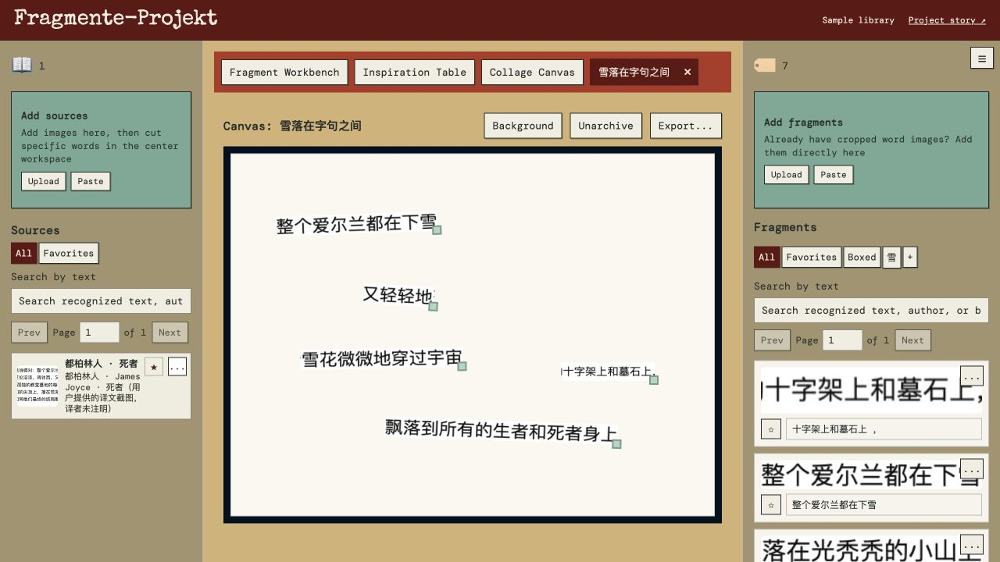

# Fragmente-Projekt

## 在线体验

**[打开中文 Demo](https://aliyehitomi359.github.io/Fragmente-Projekt/portfolio/zh.html)** · **[English Demo](https://aliyehitomi359.github.io/Fragmente-Projekt/)** · **[体验 App](https://aliyehitomi359.github.io/Fragmente-Projekt/?demo=1&lang=zh)**

[](https://aliyehitomi359.github.io/Fragmente-Projekt/portfolio/zh.html)

包含真实桌面操作录屏、中英文项目介绍，以及独立示例素材库。无需安装或登录；系统级截图仍需桌面版。这是借助 AI 编程工具实现并持续迭代的 MVP。

[English](README.md) | [简体中文](README.zh-CN.md)

本地优先的文字碎片收集与拼贴诗创作工具。使用 React、TypeScript、Vite、IndexedDB 和 Electron，无需账号或后端。目前软件界面为英文，中文版将在英文版稳定后制作。

## 功能

- 上传截图、扫描页和书页，框选文字保存为 Fragment，原图保持完整并显示裁剪痕迹。
- 自动识别简体中文、繁体中文、英文和德语，直接编辑 Fragment 的 OCR 文字。
- 使用 Boxes 和收藏整理素材；搜索文字、书名和作者等来源备注，支持简繁交叉搜索。
- Inspiration Table 随机散落纸片，可拖入临时 Session，再保存为正式 Box。
- 多画布拼贴，移动、缩放、二次裁剪纸片，自定义纯色或图片背景，导出 PNG、JPG、WebP。
- 桌面版监测本地文件夹：根目录图片通过带悬停预览的对话框分类；Sources / Fragments 图片自动导入。
- 在左右栏之间拖动图片转换分类，并移动对应本地文件。
- OCR 或手动修改文字后同步命名图片，末尾保留三位标识防止重名；上传图片复制进资料库，保留原文件。
- 菜单提供打开当前 Library、备份和恢复。

## 启动网页版

安装当前 Node.js LTS 和 npm，在项目目录执行：

```sh
npm ci
npm run dev
```

打开 http://localhost:5175/。端口被占用时会报错，不自动换端口。不要直接打开 index.html。

## 桌面开发预览

```sh
npm run desktop:dev
```

窗口标题为 Fragmente-Projekt · Development。界面代码修改自动刷新，Electron 代码修改自动重启。若 5175 上已有本项目的 Vite 服务，会复用它。

测试图片保存在桌面的 `Fragmente-Projekt Preview Library`；编辑数据保存在独立的 `Fragmente-Projekt-Development` 应用配置目录。与正式安装版资料隔离。可通过菜单 Open Library Folder 打开当前图片目录。退出使用 Command+Q 或停止终端命令。

`npm run desktop` 则构建并打开非热更新桌面版本，首次要求选择资料库位置。网页版旧资料需先导出，再导入桌面版。

## 安装包

```sh
npm run package:mac
npm run package:win
```

分别在 macOS / Windows 上生成安装包，输出到 `release/`。当前为未签名开发预览，Windows 安装包和交互仍需对应平台测试。GitHub Actions 提供两平台打包流程。生成本地安装包不会自动发布 GitHub Release。

## 保存方式和当前限制

正式版 Library 包含 `Sources`、`Fragments`、`Canvases`、`.app-data` 和 `browser-data`。编辑数据库仍在 browser-data 中，请完整保留资料库。开发预览的编辑数据库使用上述独立应用配置目录。

- Sources / Fragments 保存图片，启动时同步已有素材。
- 根目录未分类图片留在原处，分类后移动到对应子文件夹；约每三秒扫描一次。
- Canvases 当前是预留目录，尚未自动保存完成作品的渲染图片。
- Inspiration Session 与桌面摆放尚不能在关闭后恢复。
- OCR 首次下载模型，尚未完整打包离线资源。
- Restore 读取导出备份中的 manifest.json，更新同 ID 项目并保留其他项目，并非完整回滚。

安装包、个人图片和资料库数据不进入 Git。

## 检查

```sh
npm run build
node --test electron/library.test.cjs
```

后续截图和悬浮人物计划见[桌面版路线图](DESKTOP-ROADMAP.zh-CN.md)。
